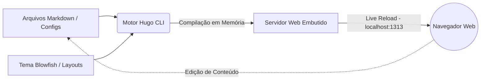

# 🌐 Tecnologia e Ativismo Digital — Projeto Web com Hugo

Este repositório contém o código-fonte e os conteúdos de um projeto web voltado para **tecnologia e ativismo digital**. O objetivo principal da iniciativa é utilizar o desenvolvimento deste site como laboratório prático para aprender a operar o gerador de sites estáticos [Hugo](https://gohugo.io/) em conjunto com o versionamento e hospedagem via [GitHub](https://github.com/).

---

## 🎯 Objetivo do Projeto

* **Aprendizado Prático:** Dominar o fluxo de criação de páginas estáticas de alta performance utilizando o ecossistema [Hugo](https://gohugo.io/).
* **Identidade Visual Moderna:** Implementar uma interface limpa, responsiva e focada em conteúdo utilizando o tema [Blowfish](https://blowfish.page/).
* **Propagação de Conteúdo:** Criar um espaço digital dedicado a debates, ferramentas e reflexões sobre tecnologia e ativismo digital.

---

## 🛠️ Tecnologias e Ambiente

O ambiente de desenvolvimento foi configurado com as seguintes ferramentas e referências:

* **Gerador de Sites Estáticos:** [Hugo](https://gohugo.io/) (escrito em Go, focado em velocidade e flexibilidade).
* **Tema:** [Blowfish](https://blowfish.page/) (desenvolvido com Tailwind CSS, oferecendo suporte a modo escuro, shortcodes avançados e layouts personalizáveis).
* **Controle de Versão:** [Git](https://git-scm.com/) e [GitHub](https://github.com/).
* **Sistema Operacional:** [Pop!_OS](https://system76.com/pop/) com o ambiente gráfico [COSMIC](https://system76.com/cosmic) (desenvolvido pela [System76](https://system76.com/)).
* **Fontes de Apoio:** [Documentação Oficial do Hugo](https://gohugo.io/documentation/), [Documentação do Tema Blowfish](https://blowfish.page/docs/welcome/) e assistência via [DeepSeek](https://www.deepseek.com/).

---

## 🏗️ Arquitetura e Estrutura do Servidor Local Hugo

Abaixo estão representados o fluxo de funcionamento do servidor local e a organização interna dos diretórios do projeto com o tema Blowfish.

### 1. Fluxo de Funcionamento (`hugo server`)



### 2. Estrutura de Diretórios no Projeto

```text
meu-projeto-hugo/
├── archetypes/          # Modelos padrão para novos arquivos de conteúdo
├── assets/              # Arquivos processados pelo Hugo Pipes (CSS, imagens, JS)
├── config/              # Configurações do site e do tema Blowfish
│   └── _default/
│       ├── hugo.toml    # Configurações gerais do Hugo
│       ├── params.toml  # Parâmetros visuais e funcionais do Blowfish
│       └── menus.toml   # Estrutura de navegação e menus
├── content/             # Páginas e artigos em formato Markdown (.md)
├── layouts/             # Sobrescritas personalizadas de templates HTML
├── public/              # Site estático final compilado (gerado no build)
├── static/              # Arquivos estáticos servidos diretamente (favicons, etc.)
└── themes/
    └── blowfish/        # Arquivos-fonte do tema Blowfish (via Git Submodule ou Hugo Module)
```

---

## 🚀 Como Executar Localmente

A montagem do servidor em ambiente Linux ([Pop!_OS COSMIC](https://system76.com/cosmic)) ocorre de forma direta após a configuração inicial do repositório:

1. **Clone o repositório:**
   ```bash
   git clone --recurse-submodules <URL_DO_SEU_REPOSITORIO>
   cd <NOME_DA_PASTA_DO_PROJETO>
   ```

2. **Inicie o servidor local do Hugo:**
   ```bash
   hugo server
   ```

3. **Acesse no navegador:**
   Abra `http://localhost:1313` para visualizar o site em tempo real com atualização automática (*Live Reload*).

---

## 🧗 Dificuldades no Percurso e Aprendizados

Durante a fase inicial de implantação, os principais desafios e descobertas envolveram:

* **Autenticação e Conexão com o GitHub:** As primeiras barreiras surgiram ao configurar a comunicação local via terminal com o comando `git`. Foi necessário compreender o funcionamento e a configuração das chaves de conexão (SSH / Tokens de Acesso) na plataforma do [GitHub](https://github.com/) para autenticar a máquina e liberar o envio (*push*) dos arquivos iniciais.
* **Curva de Aprendizado com Apoio Documental:** A configuração do servidor local e a integração com o repositório remoto foram superadas combinando consultas diretas à [documentação do Hugo](https://gohugo.io/documentation/), aos guias do [Blowfish](https://blowfish.page/docs/welcome/) e ao auxílio interativo do chatbot [DeepSeek](https://www.deepseek.com/).
* **Fluidez no Ambiente Linux:** Uma vez superada a etapa de autenticação do Git, a execução do projeto no [Pop!_OS](https://system76.com/pop/) com interface [COSMIC](https://system76.com/cosmic) mostrou-se bastante estável e descomplicada, exigindo apenas a clonagem do projeto e a execução do comando `hugo server` para manter o ambiente de desenvolvimento ativo.
